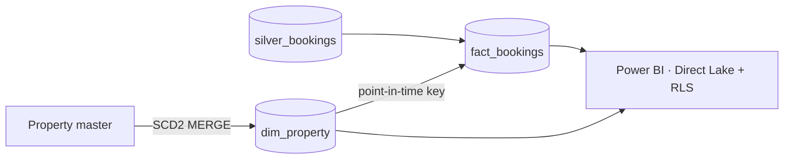

# ⭐ Fabric Gold Layer | Star Schema with SCD Type 2, built for Direct Lake


**Fabric simulation** of the gold layer for a fictional hotel chain, *Costa Azul Stays*. Property history is tracked as **SCD Type 2**, each booking gets the property version valid when it happened, and orphans land on an `UNKNOWN` member instead of vanishing. Output feeds a **Direct Lake** semantic model with **RLS**.



## Stack
`Microsoft Fabric` (Lakehouse, Warehouse, Notebooks, Semantic Model) · `Spark SQL` · `Delta Lake` · `Power BI` (Direct Lake, DAX, RLS) · `T-SQL` · `DuckDB` · `pytest` · `GitHub Actions` · `Azure DevOps`

## What it handles
- **SCD Type 2 in one MERGE:** changed attributes expire the old version and insert a new one, unchanged rows are untouched, re-runs add nothing
- **Point-in-time facts:** a March booking keeps March's region even after the property moves region in June
- **Referential integrity:** bookings with no matching property get the `UNKNOWN` key, so totals never silently drop
- **Star schema:** integer `date_key`, hashed surrogate keys, one fact and conformed dimensions
- **Capacity-aware:** Delta tables with V-Order, read by Direct Lake, so there is no import refresh burning capacity
- **Fabric Warehouse:** gold served through cross-database CTAS, with a `gold_reader` RBAC role and a T-SQL row-level security policy on dimension and fact (`sql/warehouse/`)
- **Row-level security in Power BI:** DAX role on the dimension, propagated to facts by the relationship (`semantic/rls_region_role.dax`)

## Run the tests
```bash
pip install -e ".[dev]"
pytest
```

## Run it in Fabric
1. Land `silver_bookings` (see [oci-to-fabric-lakehouse](https://github.com/lucas-wall/oci-to-fabric-lakehouse)) and a property master CSV in `Files/reference/`
2. Install the package in a Fabric Environment (`pip install "goldstar @ git+https://github.com/lucas-wall/fabric-gold-star-schema"`)
3. Run `notebooks/01_gold_build.py`, then point a Direct Lake semantic model at the gold tables and add the RLS role

> Sample data and company names are fictional.
